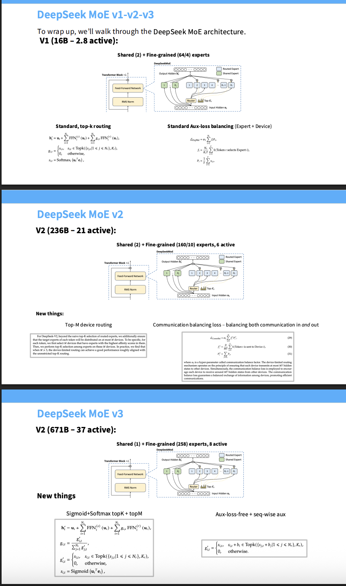
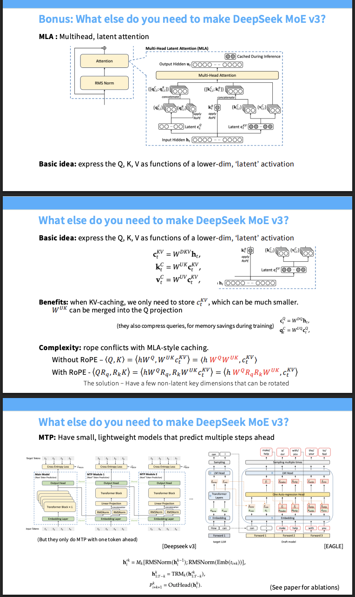

## 1.正则化的目的是为了防止数据过拟合
    L1正则化：权重的绝对值相加；L2正则化：权重的平方和
    从几何的角度理解，L1正则化容易得到稀疏矩阵，因为假设只有两个参数，其余地方gradient的绝对值为1，L2正则化不容易。
## 2.MoE：针对于FFN层（补充CS336MoE的讲解）
    DeepSeekMoE：
    top-k：softmax函数还有一个作用是归一化虽然实际上top-k策略无法使得结果为1；如果gate选择all expert那么就失去了MoE架构的优势。
    ->shared experts（不管什么token都必须经过某个expert）&fine-grained experts（将n个专家细化成2n个专家而总参数保持不变）
    
    routing的方式：
    token choice：容易出现专家负载均衡问题现在有修改损失函数来平衡的手段。DeepSeek v3: auxiliary loss free balancing
    expert choice: 可能出现token遗漏问题（这个token直接不经过FFN层和原始输入保持一致）且在自回归推理时很难起作用。
    还有RL routing和把linear assignment for routing，但都是成本比收益高。

    experts parallelism

    router z-loss:为了稳定logits。因为在softmax中如果所有logits增加一个常数，概率是不变的。

    upcycling：已经训练好的稠密模型，改造成 MoE 模型，再继续训练。

    DeepSeek v1-v2-v3: v2和v1相比架构基本没变，但是先选择了top-m个设备再在每个设备内选择top-k个experts，从而控制多个experts可能带来的沟通成本,同时损失函数追加了对输出通信成本的考虑。v3的MoE是sigmoid其余见下图(虽然MTP说一次预测两个token但是实际上还是只是1个)。

图 1：DeepSeek MoE V1、V2、V3 架构与路由机制。

图 2：DeepSeek 的多头潜在注意力（MLA）与多 token 预测（MTP）。
